# CSPC Lost & Found mobile app walkthrough

[Open the visual walkthrough](index.html) for twelve screen previews and step-by-step captions.

Source project: `/Users/justinbalbastre/Downloads/lost-and-found-app-cspc-main`.

The images render the app's existing React Native screen components through an isolated browser adapter. They use fictional records, disabled effects, mocked services, and simulated navigation parameters. These are source-based browser previews, not Android or iOS device screenshots. Native fonts, spacing, navigation, maps, permissions, and platform controls can differ. No app source files or live records have been changed.

## 1. Campus sign-in

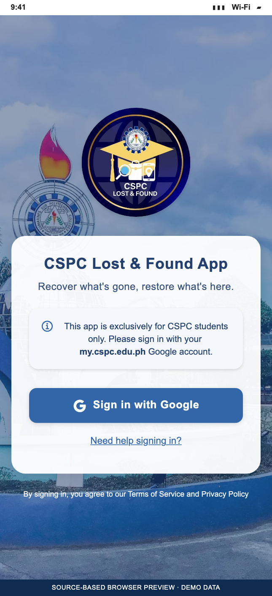

Use **Sign in with Google** with your `my.cspc.edu.ph` campus account. **Need help signing in?** opens the sign-in assistance screen.

Source: `src/features/auth/screens/LoginScreen.js`.

## 2. Browse reports

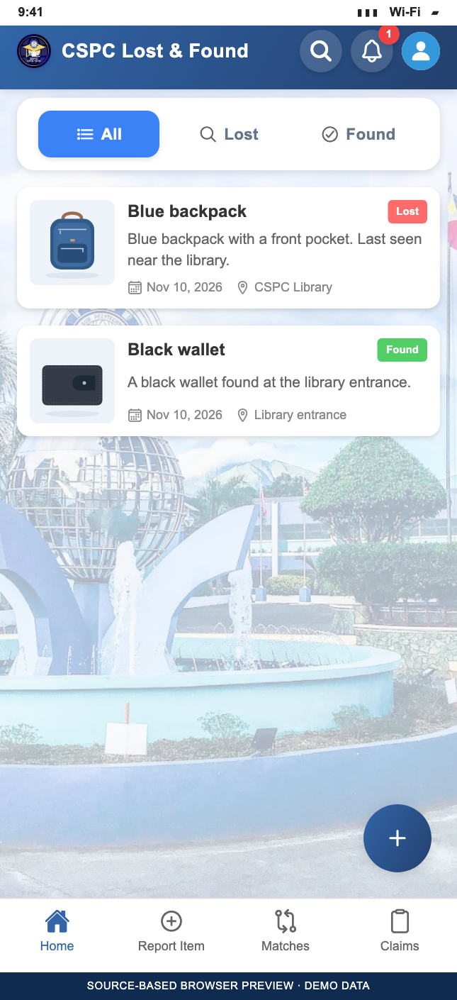

The home screen lists item reports. Switch between **All**, **Lost**, and **Found**, search for an item, open its details, or use the report action. Notifications and the user menu are available from the header. The preview includes the bottom Home, Report Item, Matches, and Claims tabs, plus sample item illustrations.

Sources: `src/features/home/screens/HomeScreen.js`, `src/navigation/AppNavigator.js`.

## 3. Report an item

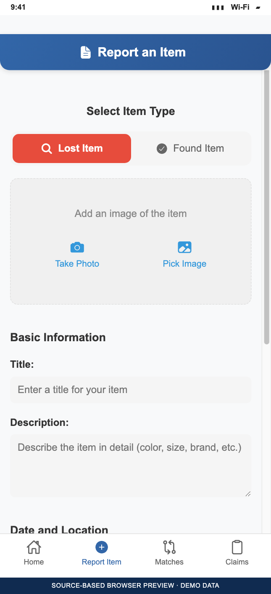

Select **Lost Item** or **Found Item**, then take or pick a photo. Enter the title and description, review the date and location information, and complete the report. The screen includes image analysis and matching integrations; those services are disabled in these previews. Read the location and turn-in instructions shown for the selected report type.

Source: `src/features/items/screens/ReportItemScreen.js`.

## 4. Inspect item details

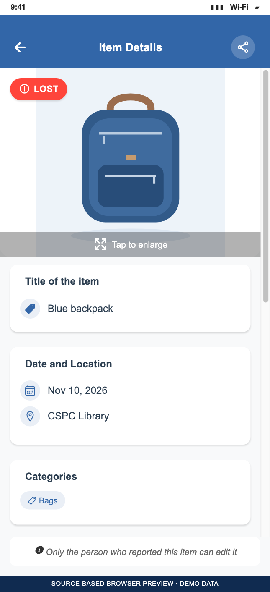

Review the item's photo, type, date, location, categories, and description. The source also supports a location map and actions that depend on item status and ownership. The preview uses a placeholder when a demo item has no photo.

Source: `src/features/items/screens/ItemDetailsScreen.js`.

## 5. Review potential matches

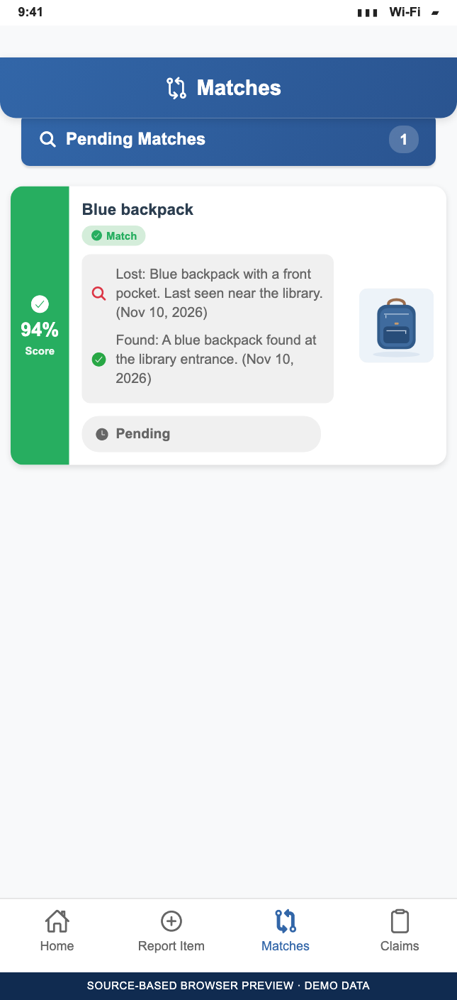

Open **Matches** to compare lost and found reports, inspect the score and confidence label, and open a candidate for further review. The lost-item owner can send an eligible pending match. A match score supports review; ownership still requires verification.

Sources: `src/features/matching/screens/MatchesScreen.js`, `src/features/matching/components/MatchCard.js`.

## 6. Submit ownership evidence

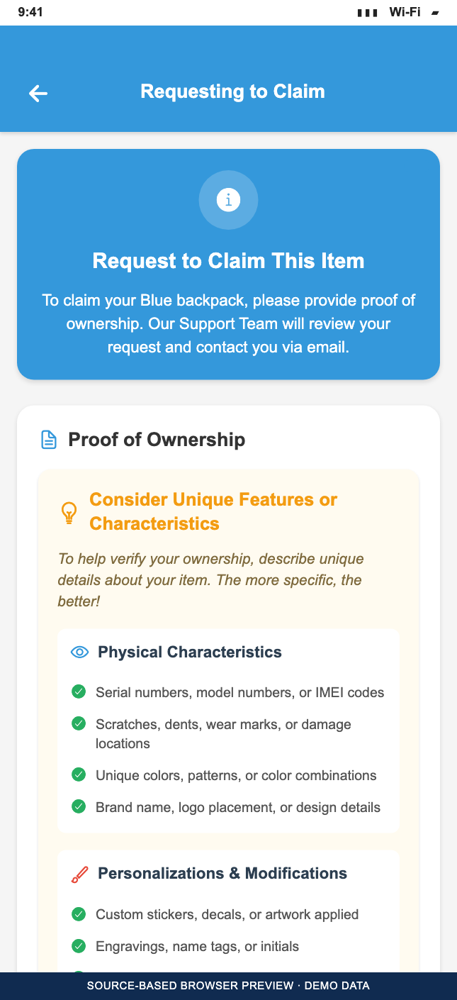

The claim screen asks for proof of ownership. Describe identifying details, such as a name inside a pocket, and provide a supporting image when appropriate. Submit the request for review and follow the support team's instructions. No request is submitted by the preview.

Source: `src/features/items/screens/ClaimItemScreen.js`.

## 7. Track claims

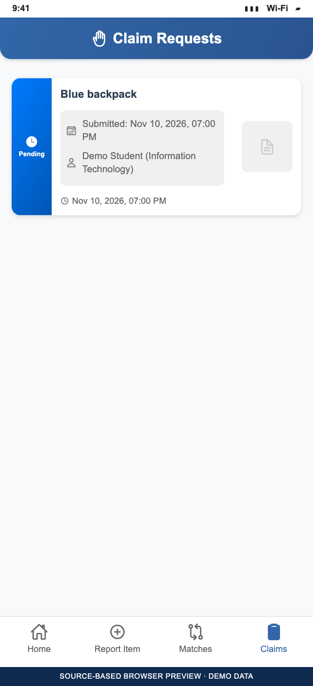

Open **Claims** to review your requests, their submission details, and their status. Open an entry for more information and follow the collection instructions if approved. Available actions depend on the request's current status.

Source: `src/features/matching/screens/ClaimRequestsScreen.js`.

## 8. Read notifications

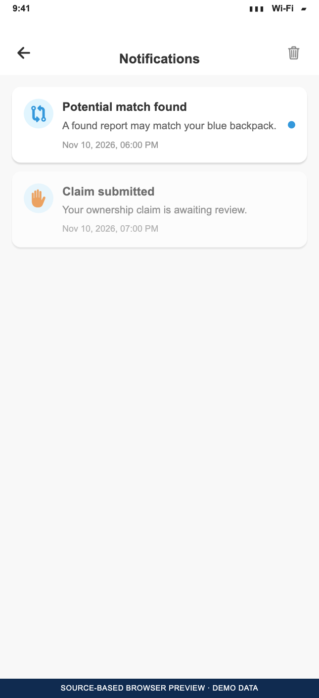

Review match and claim updates in **Notifications**. Opening a notification marks it as read and navigates to its related content when supported. The screen also includes notification cleanup controls.

Source: `src/features/notifications/screens/NotificationsScreen.js`.

## 9. Manage your profile

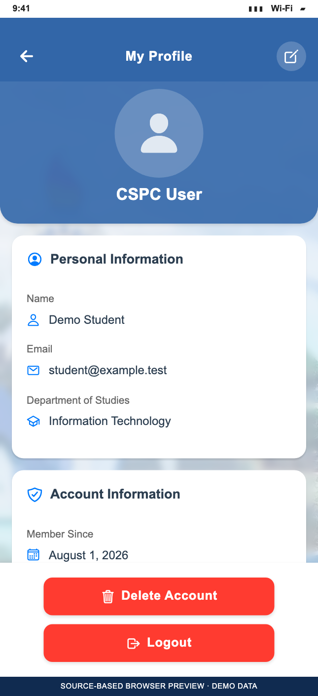

Review your name, email, department, membership information, and two-factor authentication setting. Use the edit action to update supported profile fields. Authentication and account changes are disabled in the preview.

Source: `src/features/profile/screens/UserProfileScreen.js`.

## 10. Adjust settings

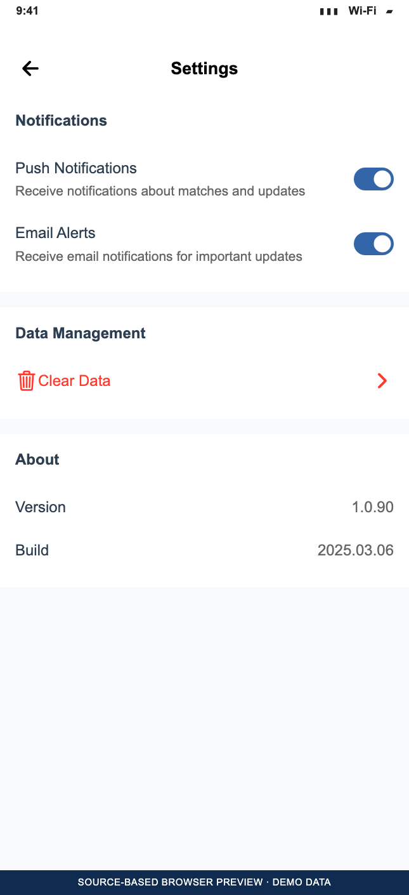

Review the **Push Notifications** and **Email Alerts** switches. The screen also provides data-management and app-version information. The preview does not change saved settings or clear data.

Source: `src/features/profile/screens/SettingsScreen.js`.

## 11. Send feedback

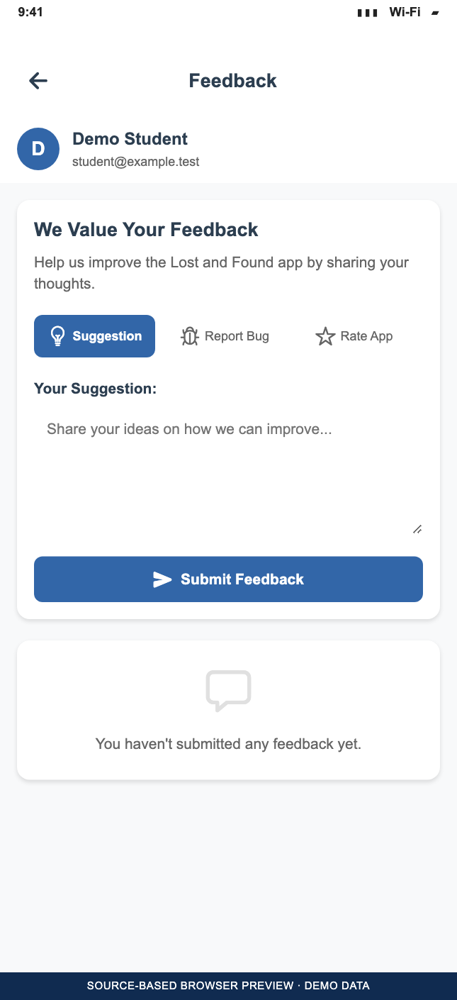

Choose **Suggestion**, **Report Bug**, or **Rate App**, enter the requested information, and submit feedback. Previous feedback and responses appear below the form when present. Demo previews do not send feedback.

Source: `src/features/profile/screens/UserFeedbackScreen.js`.

## 12. Get help and support

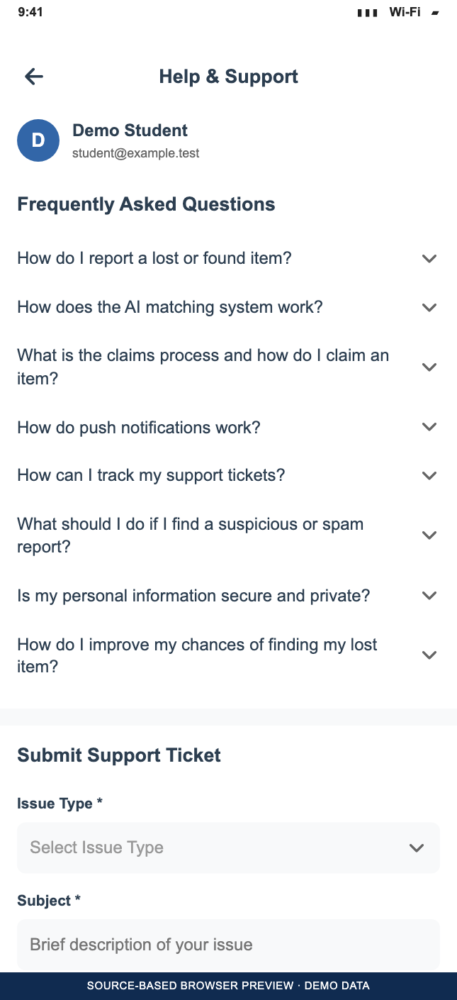

Read the frequently asked questions, expand the relevant topic, and use the support-ticket tools for an issue that needs assistance. Tickets include an issue type, subject, description, priority, and optional attachment. Existing requests and their responses can be reviewed from the same screen.

Source: `src/features/profile/screens/HelpSupportScreen.js`.

The app also includes item history, statistics, achievements, sign-in assistance, and additional detail screens beyond this walkthrough.
