# CSPC Lost & Found — visual walkthrough

[Review the updated management UI](management.html), including desktop previews.

Screenshots rendered from the existing PHP views with fictional demo data and a simulated super-admin session. These are interface previews, not a live database session or verification of backend operations. The management screens reflect the updated application. Layout and interactions were checked with isolated sample records; no live records were changed.

Start with sign-in, check the dashboard, review item records, inspect potential matches and claims, then explore reporting, users, roles, feedback, and support. This eleven-screen walkthrough uses a simulated super-admin session; access and available actions can differ for other roles. Notifications and activity logs are outside this walkthrough.

## 1. Sign in

Enter your CSPC staff email and password, then select Sign In. The deployed login also expects configured reCAPTCHA keys; the preview has no CAPTCHA credentials.

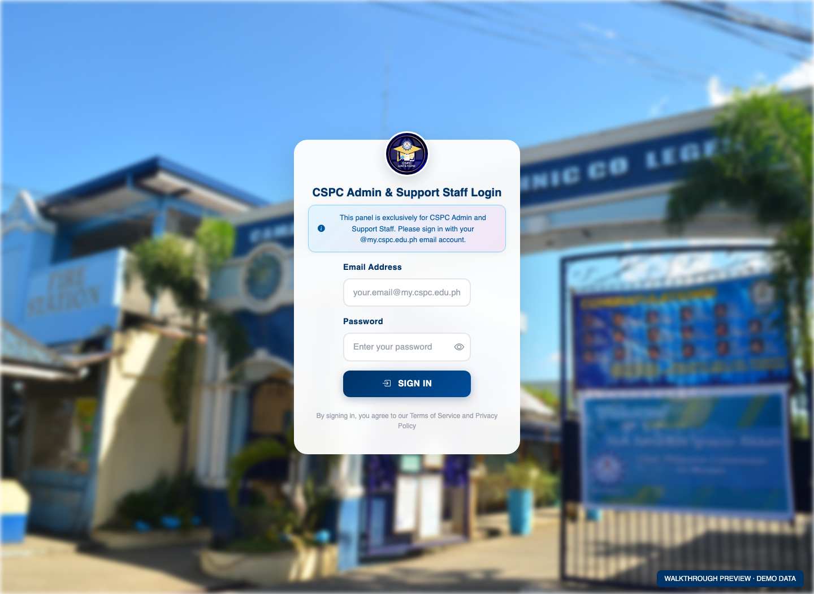

Source: [app/Views/login/index.php](../../app/Views/login/index.php)

## 2. Check the dashboard

Review total items, claimed items, pending reviews, and returns. Use weekly activity and recent activity to decide what needs attention.

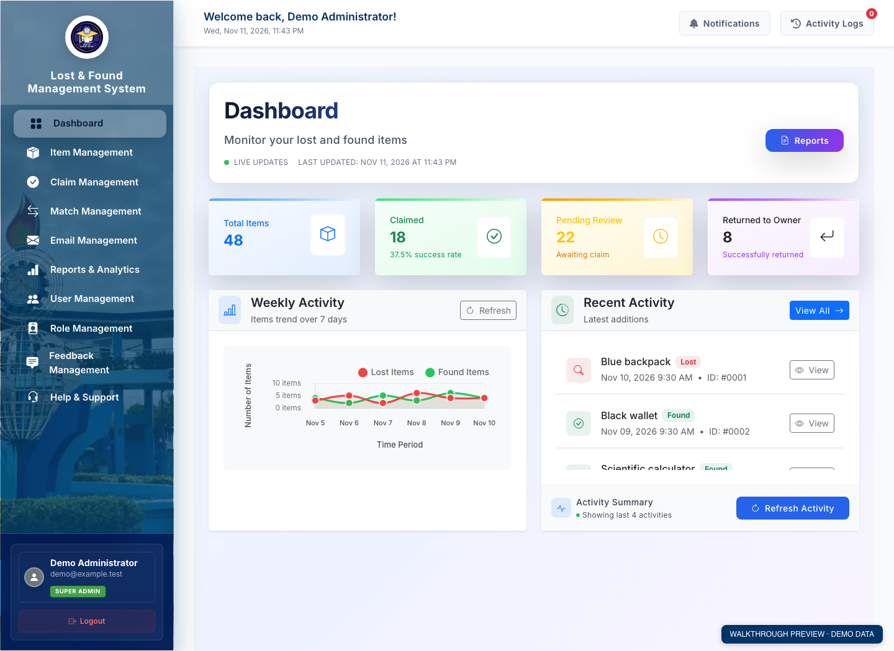

Source: [app/Views/dashboard/home.php](../../app/Views/dashboard/home.php)

## 3. Manage lost and found items

Review counts for the current page. Search across all reports by title, description, category, location, or reporter; combine category, type, and status filters. Select Preview to inspect photos and report details, use the gallery controls for additional photos, and press Escape to return to the list. Open full details leads to the complete record. The demo records and illustrations are fictional.

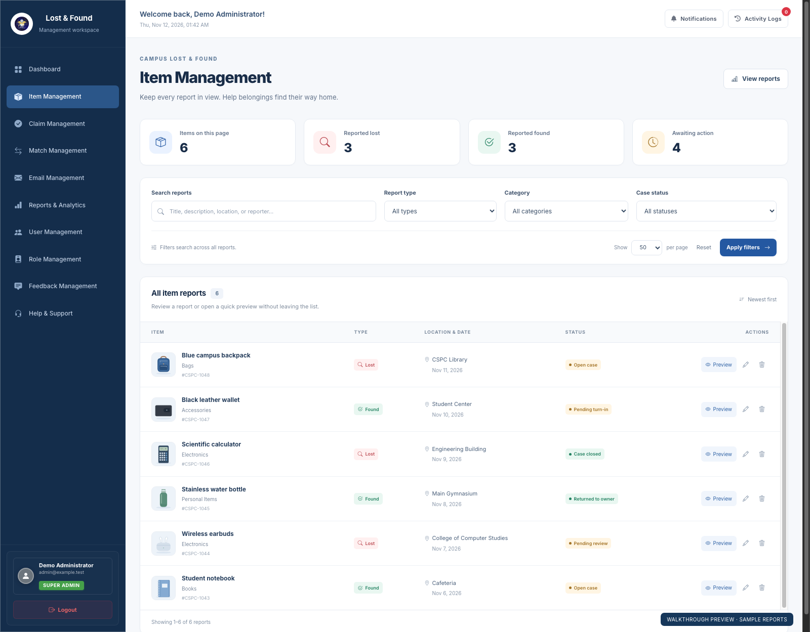

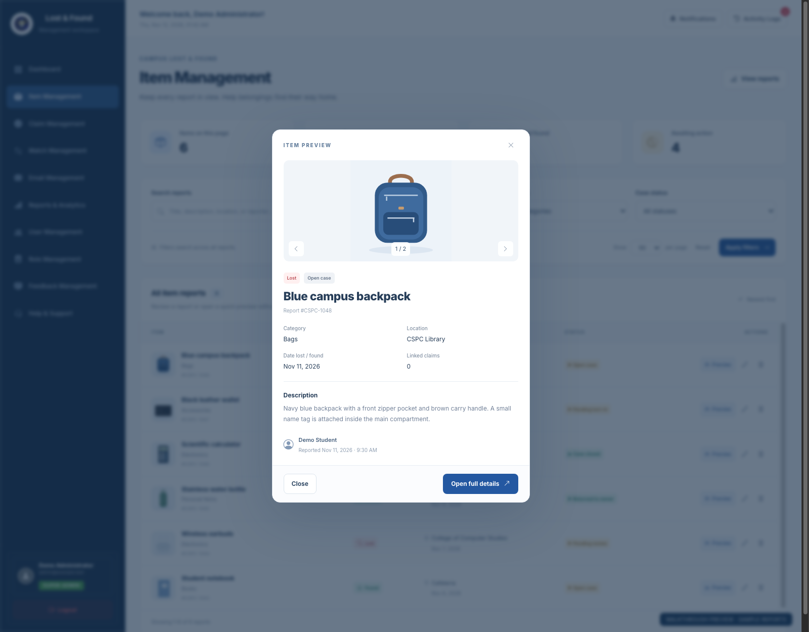

Source: [app/Views/dashboard/items.php](../../app/Views/dashboard/items.php)

## 4. Review potential matches

Open Match Management. Compare lost and found item descriptions, locations, and the match score. Open a match to review it before approving, rejecting, or resolving the case. A score is a review aid, not proof of ownership.

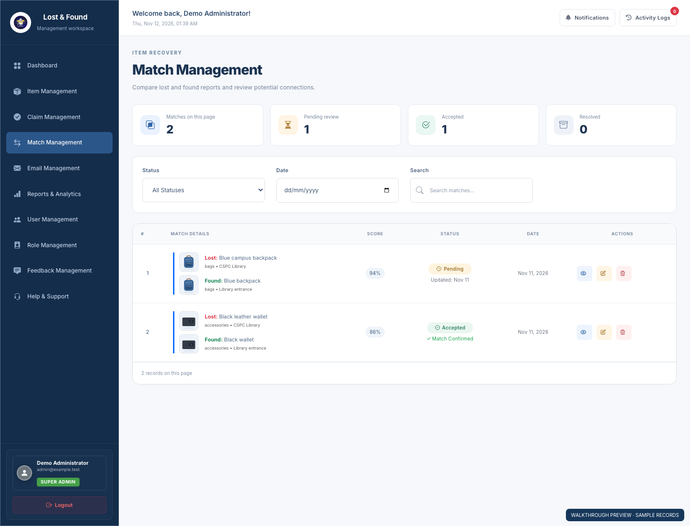

Source: [app/Views/matches/index.php](../../app/Views/matches/index.php)

## 5. Review ownership claims

Open Claim Management. Review the claimant, linked items, supporting information, and claim status before taking an available action.

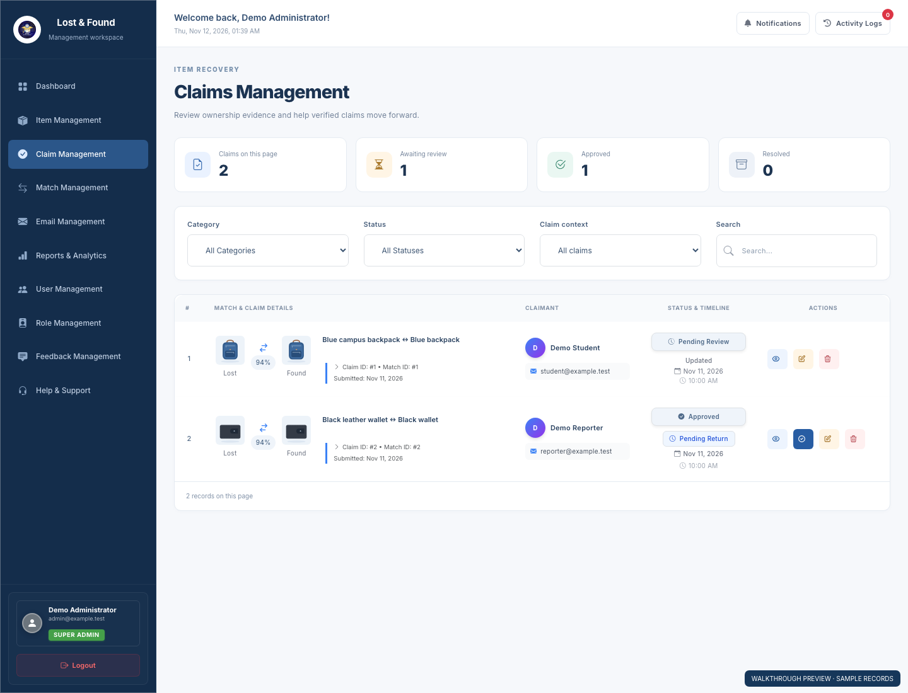

Source: [app/Views/claims/index.php](../../app/Views/claims/index.php)

## 6. Review reports and analytics

Open Reports & Analytics. Inspect item totals, claim success, average claim time, and category breakdowns. Use the filters and export controls to prepare a report.

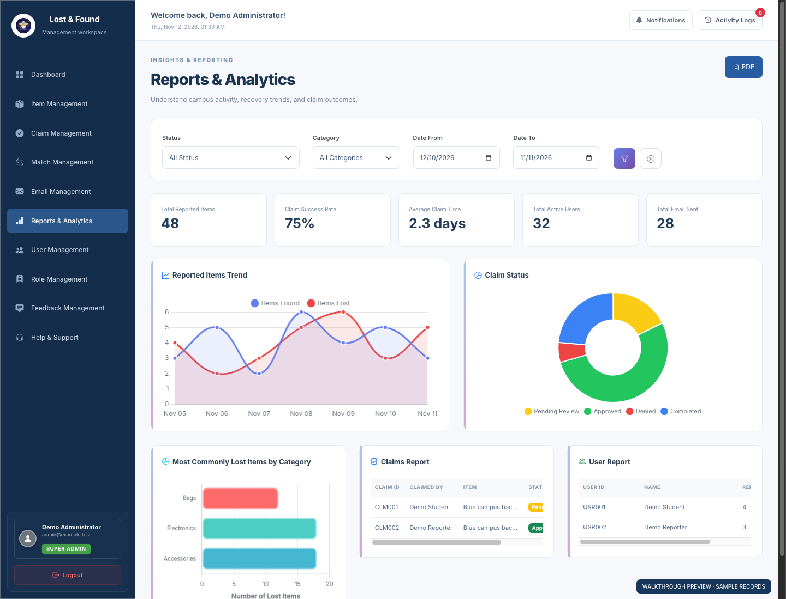

Source: [app/Views/reports/index.php](../../app/Views/reports/index.php)

## 7. Manage users

Open User Management. Search by name or email and filter by department or status. Review account status, two-factor authentication, and report counts, then use the view, edit, suspend, or delete controls for an account.

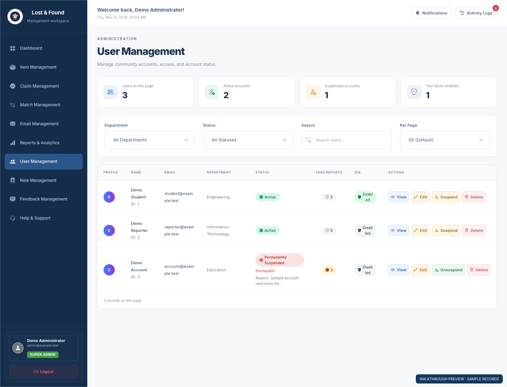

Source: [app/Views/users/index.php](../../app/Views/users/index.php)

## 8. Manage roles

Open Role Management. Search the administrative accounts and filter by role. Review the super admin, admin, and staff assignments. Open an account to inspect or edit it; the super admin can use Add New Role to create an administrative account. Available controls depend on the signed-in role.

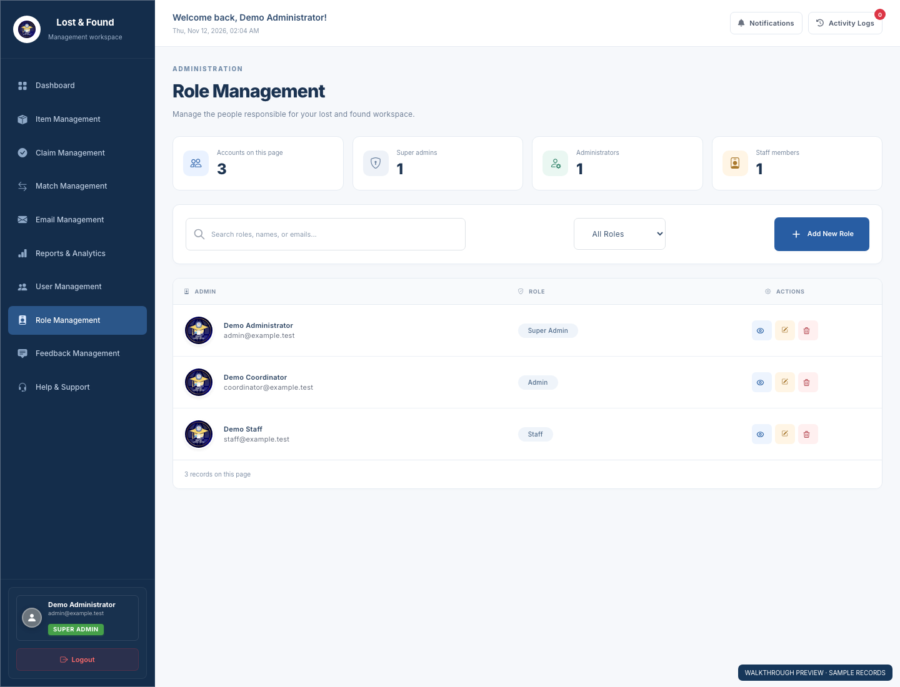

Source: [app/Views/admin_role/index.php](../../app/Views/admin_role/index.php)

## 9. Manage feedback

Open Feedback Management. Check total feedback, pending entries, addressed entries, and average rating. Filter by status, type, or rating, or search the list. Open an entry to read its details or use Respond to reply.

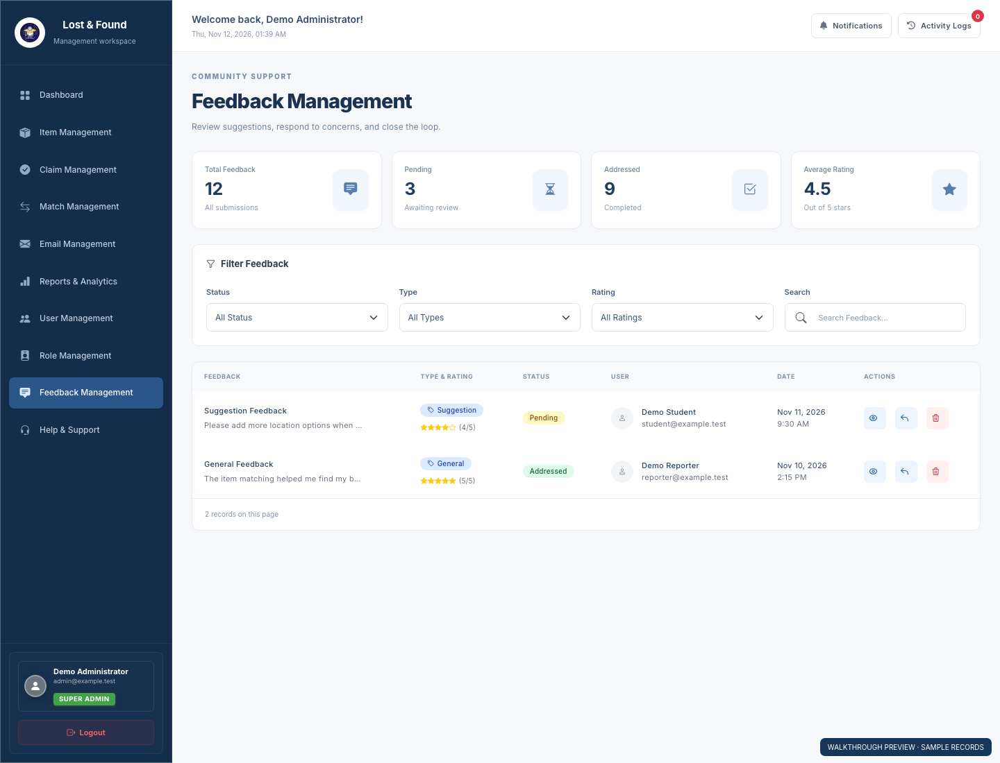

Source: [app/Views/feedback/index.php](../../app/Views/feedback/index.php)

## 10. Manage help & support

Open Help & Support. Review total, open, and in-progress tickets, then check the recent requests. Select View All Tickets to open ticket management, where staff can inspect a request, reply, and update its status.

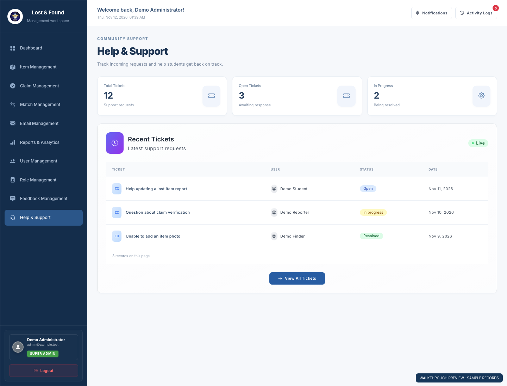

Source: [app/Views/help_support/dashboard.php](../../app/Views/help_support/dashboard.php)

## 11. Email management

Review delivery totals, filter recent messages by delivery status, search recent activity, and open delivery logs. No email was sent during the preview checks.

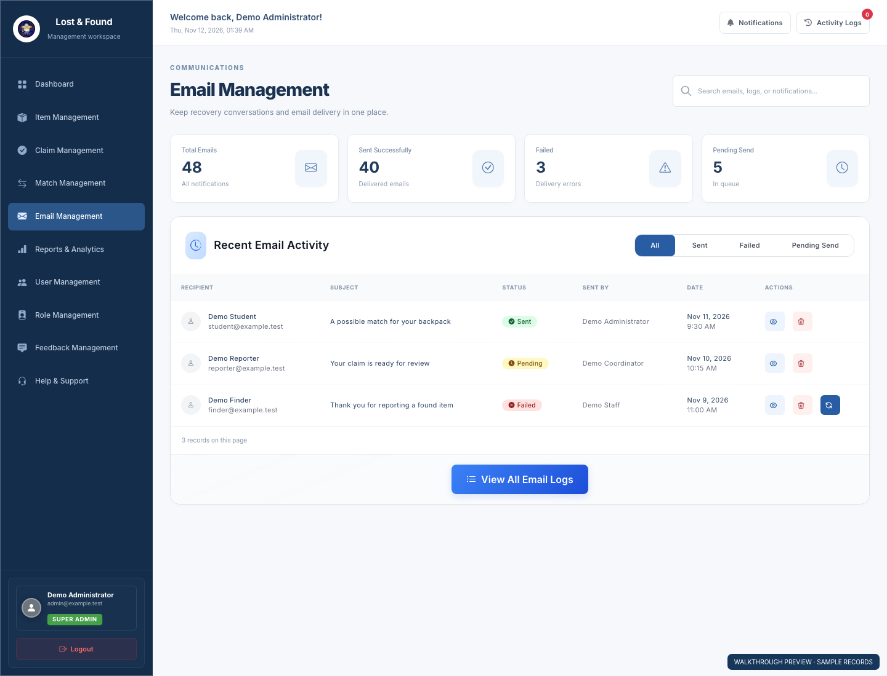

Source: [app/Views/emails/index.php](../../app/Views/emails/index.php)
